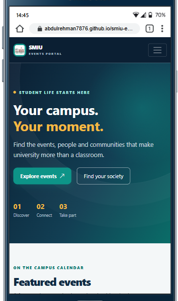
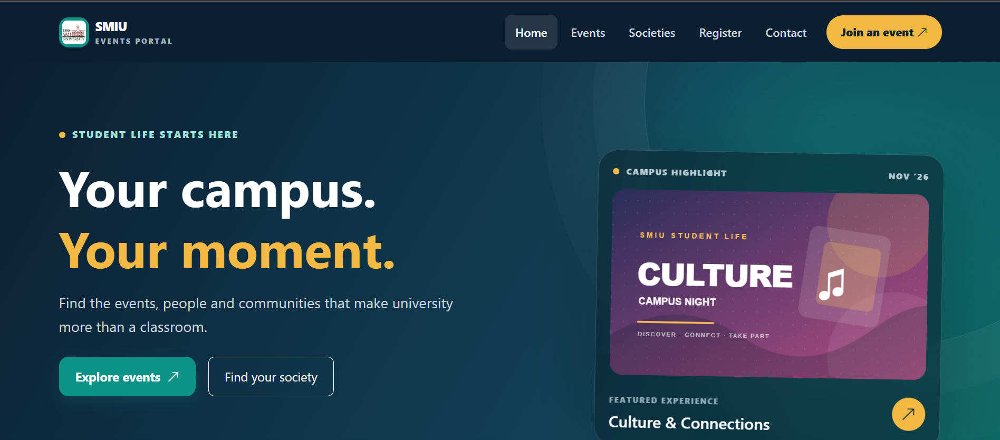
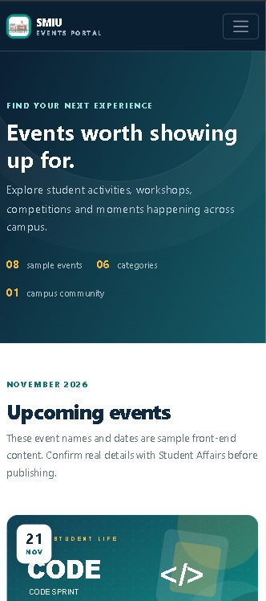
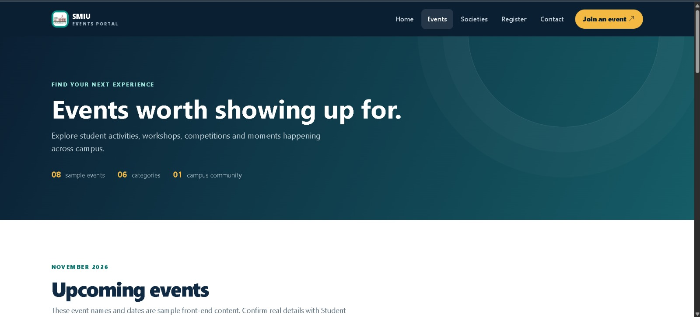
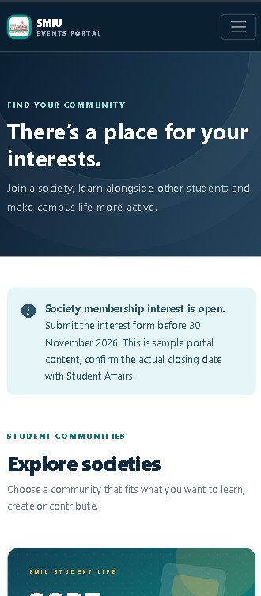
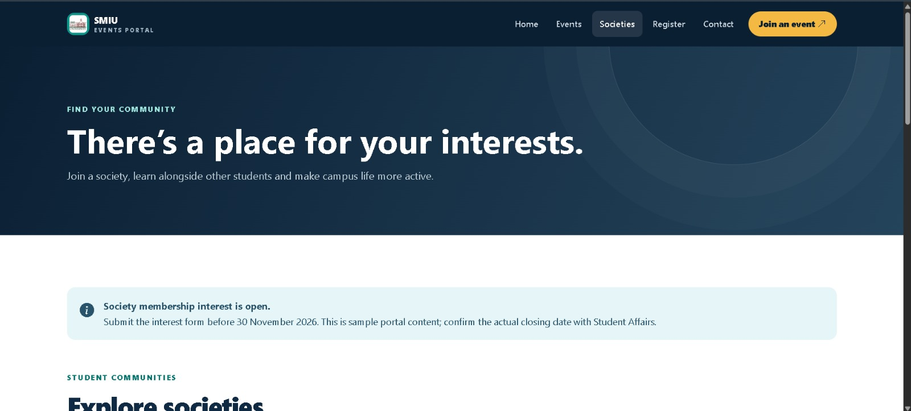
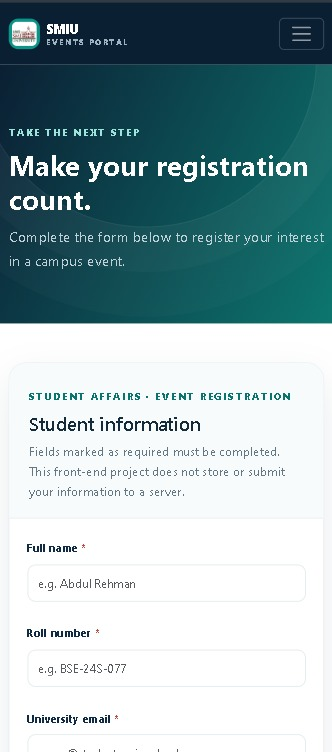
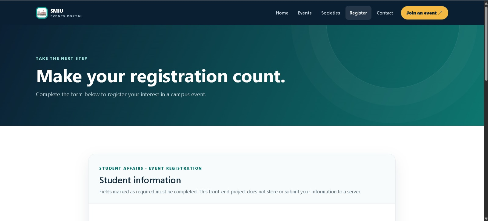
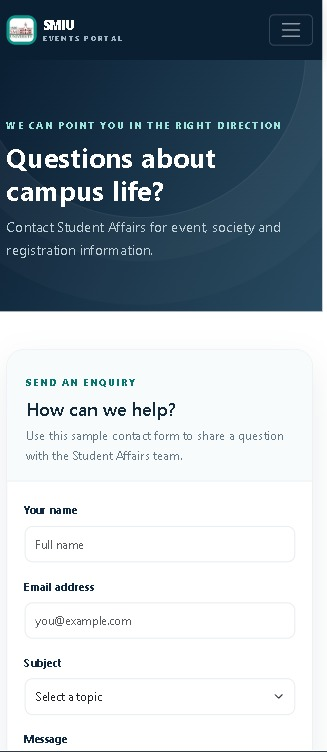
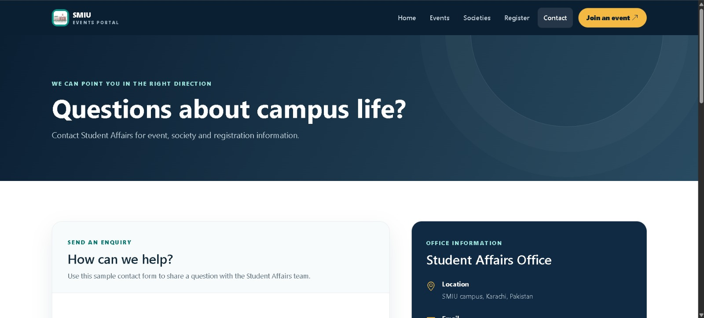

# SMIU Events Portal

A responsive front-end website concept for the SMIU Student Affairs Office. Students can browse sample campus events, read event details, explore student societies and complete demonstration registration/contact forms.

> _Important:_ Event names, dates, venues, office contact details, membership counts and staff information in this project are sample content for an academic demonstration.

## Group members

| Name            | GitHub username | Main responsibility                        |
| ----------------- | --------------- | ------------------------------------------ |
| Abdul Rehman   | abdulrehman7876 | Repository setup, shared styles, Home page |
| Abdul Ahad Haider | Abdull-ahad     | Events and Event Details pages             |
| Hassan Abbas   | AbbasMatrixs    | Societies and Registration pages           |
| Mohsin Ali     | Mohsin1492      | Contact page, README and final testing     |

## Page ownership

- Member 1: index.html, css/style.css, js/main.js, shared navbar/footer markup and local image assets.
- Member 2: events.html and event-details.html.
- Member 3: societies.html and register.html.
- Member 4: contact.html, this README, and final responsive / link testing.

## Technologies

- HTML5 and semantic page structure
- CSS3 with custom theme variables and responsive rules
- Bootstrap 5.3.3 CSS and JavaScript bundle through jsDelivr CDN
- Bootstrap Icons 1.11.3
- Original SVG illustrations stored in images/
- Vanilla JavaScript for demonstration form feedback

## Conflict
### CSS Styling Conflict

All styles in `style.css` are working as expected. However, a color conflict occurred involving three CSS classes:

- `.navbar-brand`
- `.brand-mark`
- `.portal-footer`

Color changes for `.navbar-brand` and `.brand-mark` were declined to maintain the existing styling, while the color change for `.portal-footer` was accepted and retained.

**Status:** Partially resolved — footer color updated; the other two classes retain their previous colors.

## Responsive testing

### Home page — phone screenshot

### Home page — desktop screenshot

### Event Page — phone screenshot

### Event Page — desktop screenshot

### Societies page — phone screenshot

### Societies page — desktop screenshot

### Register page — phone screenshot

### Register page — desktop screenshot

### Contact page — phone screenshot

### Contact page — desktop screenshot

